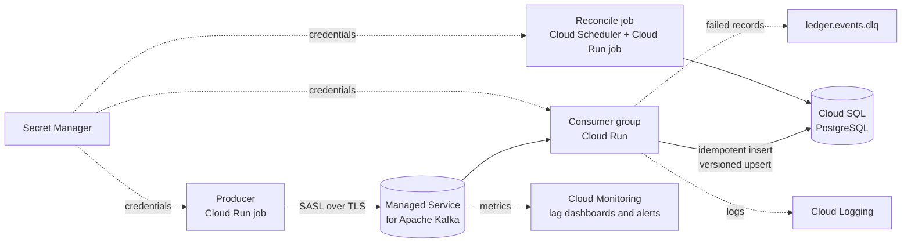

# Kafka Reliability Lab: Project Vision

> **Goal:** an interactive, public project that teaches how Apache Kafka really works when things fail, and shows what I learned while building it. It runs locally, on **Google Cloud**, and was built with **Google Antigravity** as the AI coding agent.

This repo grows out of a small local lab. This document explains what I want to build, why, and how, so that anyone visiting the repo knows where it's going and can follow along.

---

## Why this project exists

I'm learning Kafka in public. Reading documentation tells you what a setting does; it doesn't show you what happens when a consumer commits too early, when two events for the same account arrive out of order, or when you rewind a consumer group and reprocess a whole day.

This project answers those questions with something you can **see, run and break**:

- If you have **never used Kafka**, you should be able to follow it from zero.
- If you **already know Kafka**, you should find the details that show the design was thought through: commit ordering, keys and partitions, rebalances, `acks=all` with `min.insync.replicas`, the real scope of exactly-once, replay and reconciliation.

It's also my record of understanding. Every chapter states what I believe is happening and why, links to the official documentation that defines it, and points to the code that proves it.

## The scenario

One story runs through everything:

A **partner system** sends **charges, payments and account status changes**. We store charges and payments in an **append-only ledger** in PostgreSQL, where `balance = charges - payments`, and keep each account's **latest status** with a version number. Networks fail, programs crash, partners resend and events arrive out of order. The design must guarantee **no lost entries, no double-counted money and no stale status**, and a **reconciliation** job must prove it.

## What already exists

The local lab in this folder:

| Piece | What it does |
| :--- | :--- |
| `docker-compose.yml` | Kafka 3.8 in KRaft mode (no ZooKeeper), Kafka UI and PostgreSQL |
| `create_topics.py` | `ledger.events` (3 partitions) and `ledger.events.dlq` |
| `producer.py` | Plays the partner; idempotent producer, `acks=all`, keyed by account; can send duplicates, poison and shuffled versions |
| `consumer.py` | Consumer group, auto-commit off, commit after the DB write, blocking retries with backoff, DLQ topic, versioned upserts |
| `replay.py` | Shows lag, or moves the group's offsets back for a replay |
| `redrive_dlq.py` | Inspects the DLQ and replays records gradually |
| `reconcile.py` | Compares what the partner sent with the ledger and the latest statuses |
| `README.md` | 8 hands-on exercises |

## What we're going to build

### 1. An interactive learning site (GitHub Pages)

A static site, published from this repo, that explains Kafka through the ledger story:

- **Guided chapters**, each with the same shape: an everyday analogy, a question to predict what happens, a step-by-step animation you control, then why it matters, an interview-ready sentence, expert details, the matching lab code and links to the official docs.
- Planned chapters:
  1. A log, not a queue (topics, partitions, offsets)
  2. Keys, partitions and order
  3. Consumer groups and rebalancing
  4. Committing offsets: after the write
  5. Producer durability: acks and replicas
  6. Duplicates, versions and "exactly once"
  7. Retries, DLQ, lag and replay
  8. Running it on Google Cloud: what changes with a managed cluster (new)
- A **glossary** with hover definitions.
- A **sandbox**: a free-play simulator with partitions, a consumer group and challenges ("replay from offset 0 and keep the ledger correct").
- A **"What I learned"** page: my own notes, mistakes and surprises, written as I go.

### 2. The same system, deployed on Google Cloud

The local lab, moved to managed Google Cloud services, so the project shows what changes in a real cloud environment.



| Concern | Google Cloud service |
| :--- | :--- |
| Kafka cluster | Google Cloud Managed Service for Apache Kafka |
| Producer, replay, redrive, reconcile | Cloud Run jobs (images in Artifact Registry) |
| Consumer group | Long-running containers on Cloud Run (always-on CPU), scaled up to the partition count |
| Ledger and status | Cloud SQL for PostgreSQL |
| Credentials | Secret Manager and service accounts (nothing in code or env files) |
| Monitoring | Cloud Monitoring (consumer lag, DLQ volume) and Cloud Logging with correlation IDs |
| Infrastructure | Terraform, so the whole stack can be created and destroyed with one command |

What the cloud chapter will cover: authenticating clients to a managed cluster, sizing partitions for the number of consumers, alerting on lag, what a rebalance looks like when containers scale, and the cost of leaving a cluster running.

### 3. Built with Antigravity, and documented honestly

The other repo (RabbitMQ) is built with a different cloud and a different agent, so the two projects can be compared. This one uses **Google Antigravity**.

- I'll use the agent to plan and implement features in small tasks, and review the plans and artifacts it produces before accepting changes.
- An `AI_LOG.md` file will record, for each feature: what I asked the agent, what it produced, what was wrong and how I caught it, and what I decided **not** to delegate.
- What I don't delegate: the reliability rules themselves (when to commit, the idempotency key, the version check, what goes to the DLQ) and the reconciliation logic. The agent can write code; I own the guarantees.

## Design principles

These hold in every version, local or cloud:

1. **At-least-once delivery is assumed.** Duplicates will happen, especially during rebalances and replays.
2. **Key by the entity that needs order** (the account ID). No design depends on order across partitions.
3. **Commit offsets after the database write, never before.** A crash can only re-read, never skip.
4. **Entries are idempotent** (unique `external_id`); **state is versioned** (apply only newer versions).
5. **Producer durability:** `acks=all`, idempotent producer, `min.insync.replicas` set on the topic.
6. **Retries are short and capped**, then the DLQ topic, with the source partition and offset in the headers.
7. **Replay is safe because writes are idempotent**, and every replay ends with reconciliation.
8. **Every log line carries a correlation ID.**

## Roadmap

- [ ] **Phase 1:** Split into its own repository; clean README; tests with pytest (validation, idempotent insert, versioned upsert, DLQ routing).
- [ ] **Phase 2:** GitHub Pages site with chapters 1 to 7, glossary and sandbox.
- [ ] **Phase 3:** Terraform for Google Cloud; deploy producer, consumer group and reconcile on Cloud Run with Managed Service for Apache Kafka and Cloud SQL.
- [ ] **Phase 4:** Lag and DLQ dashboards with alerts; chapter 8 (running on Google Cloud); screenshots and a short recorded walkthrough.
- [ ] **Phase 5:** A non-blocking retry topic compared with blocking retries; an event schema with a deliberate breaking change; "What I learned" page; `AI_LOG.md` complete.
- [ ] **Stretch:** A small "live run" page that shows the results of the last cloud run (lag, DLQ, reconciliation) from a published JSON file.

## Planned repository structure

```
kafka-reliability-lab/
├── lab/                 # local version: docker-compose, producer, consumer, replay, redrive, reconcile
├── tests/               # pytest
├── infra/gcp/           # Terraform: Managed Kafka, Cloud SQL, Cloud Run, Monitoring, Secret Manager
├── docs/                # GitHub Pages: chapters, glossary, sandbox, what-I-learned
├── AI_LOG.md            # how Antigravity was used, what it got wrong, what I didn't delegate
└── README.md
```

## What "done" looks like

- Someone new to Kafka can go through the site and explain partitions, offsets, consumer groups and replay in their own words.
- Someone experienced can open any chapter, follow the doc links and the code, and find nothing hand-wavy.
- `terraform apply` brings the Google Cloud version up, a scripted run produces events with duplicates, failures, poison and out-of-order versions, a replay runs, and reconciliation passes. `terraform destroy` removes everything.

## Cost and safety

- A managed Kafka cluster and a database cost money while they run. The Google Cloud stack is meant to be **created for a demo and destroyed afterwards**. A budget alert is part of Phase 3.
- No real customer or financial data, ever. All events are generated.
- This is a learning project, not a production system. The official Apache Kafka and Google Cloud documentation, linked throughout, is the authority.

## Related

- **RabbitMQ Reliability Lab:** the same ledger story on RabbitMQ, deployed on AWS and built with Kiro, for comparison.
- Apache Kafka documentation: https://kafka.apache.org/documentation/

---

*Author: Rubén Oliveros. Built to learn, and to show what I learned.*
