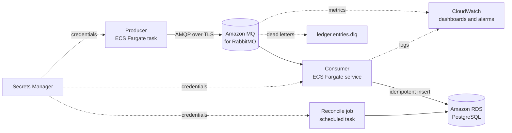

# RabbitMQ Reliability Lab: Project Vision

> **Goal:** an interactive, public project that teaches how RabbitMQ really works when things fail, and shows what I learned while building it. It runs locally, on **AWS**, and was built with **Kiro** as the AI coding agent.

This repo grows out of a small local lab. This document explains what I want to build, why, and how, so that anyone visiting the repo knows where it's going and can follow along.

---

## Why this project exists

I'm learning RabbitMQ in public. Reading documentation tells you what a feature does; it doesn't show you what happens when a consumer crashes halfway through, when a partner sends the same payment twice, or when the database goes down for ten minutes.

This project answers those questions with something you can **see, run and break**:

- If you have **never used RabbitMQ**, you should be able to follow it from zero.
- If you **already know RabbitMQ**, you should find the details that show the design was thought through: acknowledgement timing, delay queues, poison message handling, quorum queues, reconciliation.

It's also my record of understanding. Every chapter states what I believe is happening and why, links to the official documentation that defines it, and points to the code that proves it.

## The scenario

One story runs through everything:

A **partner system** sends **charges and payments** for customer accounts. We store each one in an **append-only ledger** in PostgreSQL, where `balance = charges - payments`. Networks fail, programs crash and partners resend. The design must guarantee **no lost entries and no double-counted money**, and a **reconciliation** job must prove it.

## What already exists

The local lab in this folder:

| Piece | What it does |
| :--- | :--- |
| `docker-compose.yml` | RabbitMQ (with management UI) and PostgreSQL |
| `producer.py` | Plays the partner; publisher confirms, persistent messages, can send duplicates and poison messages |
| `consumer.py` | Manual acks after the DB commit, prefetch, idempotent insert, tiered retries (5s, 20s, 60s), DLQ |
| `redrive.py` | Inspects the DLQ and replays messages gradually |
| `reconcile.py` | Compares what the partner sent with what the ledger holds |
| `README.md` | 7 hands-on exercises |

## What we're going to build

### 1. An interactive learning site (GitHub Pages)

A static site, published from this repo, that explains RabbitMQ through the ledger story:

- **Guided chapters**, each with the same shape: an everyday analogy, a question to predict what happens, a step-by-step animation you control, then why it matters, an interview-ready sentence, expert details, the matching lab code and links to the official docs.
- Planned chapters:
  1. How a message travels (producer, exchange, binding, queue, consumer)
  2. Acknowledgements: ack after the write
  3. Duplicates and idempotency
  4. Prefetch, competing consumers and order
  5. Retries with delay queues (TTL + dead letter exchange)
  6. Poison messages, the DLQ and redrive
  7. Running it on AWS: what changes with a managed broker (new)
- A **glossary** with hover definitions.
- A **sandbox**: a free-play simulator with challenges ("make reconciliation fail using only crashes").
- A **"What I learned"** page: my own notes, mistakes and surprises, written as I go.

### 2. The same system, deployed on AWS

The local lab, moved to managed AWS services, so the project shows what changes in a real cloud environment.



| Concern | AWS service |
| :--- | :--- |
| Broker | Amazon MQ for RabbitMQ |
| Producer, consumer, redrive, reconcile | Containers on ECS Fargate (images in ECR) |
| Ledger | Amazon RDS for PostgreSQL |
| Credentials | AWS Secrets Manager (nothing in code or env files) |
| Monitoring | CloudWatch: queue depth, unacked messages, DLQ depth, consumer errors |
| Infrastructure | Terraform, so the whole stack can be created and destroyed with one command |

What the cloud chapter will cover: TLS connections to the broker, where credentials live, alarms on DLQ depth and queue growth, what happens when the broker restarts or fails over, and the cost of leaving things running.

### 3. Built with Kiro, and documented honestly

The second repo (Kafka) is built with a different cloud and a different agent, so the two projects can be compared. This one uses **Kiro**.

- I'll use Kiro's spec-driven workflow: requirements, then design, then tasks, before code.
- An `AI_LOG.md` file will record, for each feature: what I asked the agent, what it produced, what was wrong and how I caught it, and what I decided **not** to delegate.
- What I don't delegate: the reliability rules themselves (when to ack, what counts as a duplicate, what goes to the DLQ) and the reconciliation logic. The agent can write code; I own the guarantees.

## Design principles

These hold in every version, local or cloud:

1. **At-least-once delivery is assumed.** Duplicates will happen.
2. **Consumers are idempotent.** The partner's `external_id` is a unique key; a redelivery is a no-op.
3. **Ack after the commit, never before.** A crash can only cause a duplicate, never a loss.
4. **Retry only what can succeed later**, with growing delays and a cap.
5. **Poison goes straight to the DLQ** with a reason. Redrive is gradual and skips poison.
6. **Reconciliation is the proof.** Every scenario ends with source and destination compared.
7. **Every log line carries a correlation ID.**

## Roadmap

- [ ] **Phase 1:** Split into its own repository; clean README; tests with pytest (validation, idempotent insert, retry routing).
- [ ] **Phase 2:** GitHub Pages site with chapters 1 to 6, glossary and sandbox.
- [ ] **Phase 3:** Terraform for AWS; deploy producer, consumer and reconcile on ECS Fargate with Amazon MQ and RDS.
- [ ] **Phase 4:** CloudWatch dashboard and alarms; chapter 7 (running on AWS); screenshots and a short recorded walkthrough.
- [ ] **Phase 5:** Quorum queues and their delivery limit compared with the classic queue setup; "What I learned" page; `AI_LOG.md` complete.
- [ ] **Stretch:** A small "live run" page that shows the results of the last cloud run (counts, DLQ, reconciliation) from a published JSON file.

## Planned repository structure

```
rabbitmq-reliability-lab/
├── lab/                 # local version: docker-compose, producer, consumer, redrive, reconcile
├── tests/               # pytest
├── infra/aws/           # Terraform: Amazon MQ, RDS, ECS Fargate, CloudWatch, Secrets Manager
├── docs/                # GitHub Pages: chapters, glossary, sandbox, what-I-learned
├── AI_LOG.md            # how Kiro was used, what it got wrong, what I didn't delegate
└── README.md
```

## What "done" looks like

- Someone new to RabbitMQ can go through the site and explain acks, idempotency, retries and the DLQ in their own words.
- Someone experienced can open any chapter, follow the doc links and the code, and find nothing hand-wavy.
- `terraform apply` brings the AWS version up, a scripted run publishes events with duplicates, failures and poison, and reconciliation passes. `terraform destroy` removes everything.

## Cost and safety

- Managed brokers and databases cost money while they run. The AWS stack is meant to be **created for a demo and destroyed afterwards**. A budget alert is part of Phase 3.
- No real customer or financial data, ever. All events are generated.
- This is a learning project, not a production system. The official RabbitMQ and AWS documentation, linked throughout, is the authority.

## Related

- **Kafka Reliability Lab:** the same ledger story on Kafka, deployed on Google Cloud and built with a different AI agent, for comparison.
- RabbitMQ documentation: https://www.rabbitmq.com/docs

---

*Author: Rubén Oliveros. Built to learn, and to show what I learned.*
